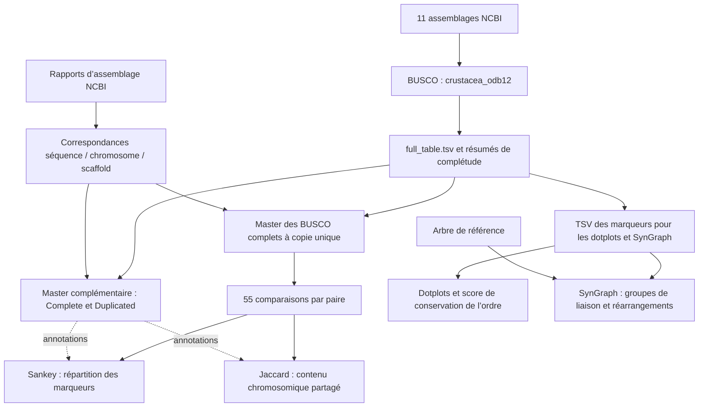

# Synténie et évolution de l’organisation chromosomique chez les Décapodes

**Projet tutoré universitaire - 2026**  
**Auteurs :** Tsiambaka Pierana RANDAOHARISON, Jad EL AYOUBI et Aurélio VITALE.  
**Dépôt :** [tsiamba/Syntenie_des_decapodes](https://github.com/tsiamba/Syntenie_des_decapodes).

Ce projet compare **dix génomes de Décapodes et un Isopode utilisé comme groupe externe**, à partir de marqueurs orthologues BUSCO. Il examine la conservation du contenu chromosomique, l’ordre des marqueurs et les scénarios de réarrangements susceptibles d’expliquer les différences entre assemblages. Les onze génomes permettent **55 comparaisons deux à deux**.

## 1. Contexte et question biologique

La **synténie** désigne ici le maintien de gènes sur un même chromosome au cours de l’évolution. Nous distinguons la **macrosynténie**, étudiée par la conservation du contenu chromosomique, de la **colinéarité**, qui concerne la conservation de l’ordre des marqueurs. Deux chromosomes peuvent ainsi conserver une grande partie de leur contenu tout en présentant un ordre interne remanié. À plus grande échelle, ces correspondances peuvent contribuer à identifier des **groupes de liaison ancestraux**, ou ALG (*ancestral linkage groups*). [Simakov et al., 2022](https://doi.org/10.1126/sciadv.abi5884).

Les Décapodes regroupent notamment les crevettes, les crabes, les écrevisses, les langoustes et les homards. Leur diversité s’accompagne d’une forte variation de l’organisation génomique : dans notre échantillon, les assemblages de Décapodes comportent de **43 à 100 chromosomes nucléaires identifiés**. Cette variation pose la question de l’homologie des chromosomes entre espèces et de la persistance de groupes de gènes liés malgré les fissions, fusions ou autres réarrangements.

L’étude de ces génomes a longtemps été compliquée par leur taille, leur richesse en séquences répétées et la difficulté à obtenir des assemblages continus. Ces obstacles sont notamment documentés chez la crevette *Penaeus vannamei*, nommée *Litopenaeus vannamei* dans la publication, et le crabe *Eriocheir sinensis*. Les lectures longues et l’ancrage chromosomique rendent désormais accessibles des comparaisons à l’échelle des chromosomes. Les caractéristiques des assemblages publiés dans ces études ne doivent pas être confondues avec celles des versions sélectionnées ici. [Zhang et al., 2019](https://doi.org/10.1038/s41467-018-08197-4), [Cui et al., 2021](https://doi.org/10.1038/s41467-021-22604-3).

**Question centrale : une macrosynténie subsiste-t-elle entre les génomes des Décapodes malgré leurs différences de nombre de chromosomes ?**

L’hypothèse de travail est que certaines associations ancestrales de gènes persistent malgré des changements de découpage chromosomique. Nous cherchons successivement à décrire le contenu partagé, examiner l’ordre des marqueurs, quantifier sa conservation et explorer les réarrangements ainsi que les ALG avec SynGraph. L’origine de la grande taille des génomes et les éventuelles contraintes fonctionnelles constituent des questions de contexte ; les analyses de marqueurs seules ne permettent pas d’en établir les causes.

## 2. Génomes et ressources

### Échantillonnage

Les assemblages ont été sélectionnés parmi les données NCBI en recherchant un niveau chromosomique, une bonne contiguïté, une diversité taxonomique et une variation du nombre de chromosomes. Les critères initiaux visaient un **N50 des contigs d’au moins 200 kb** et **au moins 90 % de BUSCO complets à copie unique**. Ce dernier objectif n’est pas atteint par tous les résultats de la série finale ; les valeurs sont présentées en section 6, avec les limites correspondantes.

| Espèce | Accession versionnée | Groupe représenté | Chromosomes nucléaires de l’assemblage |
|---|---|---|---:|
| *Macrobrachium nipponense* | GCF_015104395.2 | Crevette d’eau douce | 49 |
| *Macrobrachium rosenbergii* | GCF_040412425.1 | Crevette d’eau douce | 59 |
| *Penaeus chinensis* | GCF_019202785.1 | Crevette pénéide | 43 |
| *Penaeus vannamei* | GCF_042767895.1 | Crevette pénéide | 44 |
| *Eriocheir sinensis* | GCF_024679095.1 | Crabe | 70 |
| *Portunus trituberculatus* | GCF_017591435.1 | Crabe | 50 |
| *Scylla paramamosain* | GCF_035594125.1 | Crabe | 49 |
| *Procambarus clarkii* | GCF_040958095.1 | Écrevisse | 94 |
| *Cherax quadricarinatus* | GCF_038502225.1 | Écrevisse | 100 |
| *Panulirus ornatus* | GCF_036320965.1 | Langouste | 73 |
| *Jaera praehirsuta* | GCA_965208005.1 | Isopode, groupe externe | 11 |

Ces nombres décrivent les chromosomes identifiés dans les versions d’assemblage utilisées, d’après leurs métadonnées. Ils ne sont pas des mesures cytologiques de **2n** et ne correspondent pas nécessairement au nombre de chromosomes affichés dans une comparaison après filtrage des marqueurs.

Les accessions et statistiques d’assemblage sont conservées dans [genomes/](genomes/), notamment [genomes_info.tsv](genomes/genomes_info.tsv). Ses statistiques BUSCO historiques en `arthropoda_odb10` doivent être distinguées de la série finale en `crustacea_odb12`.

### Calcul et environnements

Les analyses ont été réalisées principalement sur le serveur distant `ptu`, disposant de **16 Go de RAM et 8 cœurs**. Certaines étapes BUSCO dépassaient les ressources disponibles ; cinq résultats ont été fournis par l’enseignant après calcul sur des machines plus puissantes.

Les environnements sont séparés selon les analyses : `env_busco`, `env_sankey`, `env_dotplot` et `env_syngraph`, sous `/data/projet2/conda/`. Les fichiers YAML disponibles sont regroupés dans [envs/](envs/) ; les versions et commandes historiques sont consignées dans [versions.txt](versions.txt), [envs/versions.txt](envs/versions.txt) et le [cahier de laboratoire](cahier_labo.md). Un environnement installé aujourd’hui ne suffit pas à déterminer les versions utilisées pour un ancien résultat : les résumés et journaux de chaque run restent la référence.

L’environnement Sankey a été configuré avec **Python 3.12** ; l’environnement BUSCO local consigné utilise **Python 3.10**. Les dotplots reposent sur Pandas, NumPy, SciPy, Matplotlib et Plotly. Ces installations distinctes permettent de conserver les dépendances propres à chaque étape.

## 3. Workflow



## 4. Méthodes

### BUSCO : marqueurs et complétude

BUSCO (*Benchmarking Universal Single-Copy Orthologs*) recherche des groupes orthologues attendus dans un lignage. Il fournit à la fois une évaluation du contenu génique attendu et des positions de marqueurs utilisables pour la comparaison. Les catégories sont : **S**, complets à copie unique ; **D**, complets dupliqués ; **F**, fragmentés ; **M**, manquants, avec **C = S + D**. Un BUSCO manquant n’établit pas à lui seul une perte biologique. [Manni et al., 2021](https://doi.org/10.1093/molbev/msab199).

Les premiers essais utilisaient MetaEuk et `arthropoda_odb10`. La série retenue utilise **Miniprot et `crustacea_odb12`**, créé le **22 mai 2026**, comprenant **1 536 groupes BUSCO**. Elle rassemble six calculs locaux avec BUSCO **6.1.0** / Miniprot **0.18-r281**, et cinq résultats avec BUSCO **5.8.2** / Miniprot **0.13-r248**. Cette différence de versions constitue une limite méthodologique documentée dans [la synthèse BUSCO](Analyses/busco_crustacea_odb12.md).

Les essais `arthropoda_odb10` et `crustacea_odb12.2` restent historiques. Les changements de lignage, de version OrthoDB et de critères de classification empêchent d’interpréter directement un écart de score comme une amélioration du même assemblage. Les comparaisons de positions utilisent un même jeu de groupes BUSCO. [Guide BUSCO](https://busco.ezlab.org/busco_userguide.html).

### Masters et identification des chromosomes

Trois tables structurent les analyses :

| Fichier | Contenu et usage |
|---|---|
| `genomes/identifiant_chr_scaffold.tsv` | Correspondances exactes entre séquences, rôles et noms de chromosomes, dérivées des rapports NCBI. |
| `genomes/master_positions_busco.tsv` | Positions des BUSCO complets à copie unique, avec accession, chromosome, coordonnées, brin et provenance. |
| `genomes/master_duplication_gene.tsv` | Loci `Complete` et `Duplicated`, avec nombres de copies, utilisés pour les annotations complémentaires. |

Les numéros de chromosomes sont propres à chaque assemblage. Les identifiants `NC`, `NW` ou `OZ` ne suffisent pas à établir le rôle d’une séquence : la validation repose sur les métadonnées. Chez *Jaera*, par exemple, `OZ242385.1` à `OZ242395.1` correspondent aux onze chromosomes nucléaires, tandis que `OZ242396.1` correspond à la mitochondrie.

Après suppression de FASTA et d’anciens dossiers volumineux pour libérer de l’espace, les correspondances ont été reconstruites à partir des seuls rapports d’assemblage. Les figures peuvent être régénérées à partir des masters sans retélécharger les génomes. La reconstruction des masters nécessite, elle, les tables BUSCO sources et les métadonnées.

### Sankey et Jaccard : contenu partagé

Pour chaque paire, les scripts retiennent les BUSCO complets à copie unique communs aux deux génomes. Un marqueur contribue à un seul couple de séquences ; les identifiants ambigus ou répétés sont exclus.

Le **Sankey** représente les séquences de chaque assemblage par des nœuds ; l’épaisseur d’un lien est le nombre de marqueurs communs. Il peut inclure des scaffolds, identifiés comme tels. La **carte Jaccard**, en mode chromosomique, conserve les marqueurs situés sur des chromosomes nucléaires des deux côtés. Pour les ensembles de marqueurs A et B de deux chromosomes :

```text
J(A, B) = nombre de marqueurs partagés / nombre de marqueurs présents dans A ou B
```

Le Jaccard varie de 0 à 1. Un score de 1 signifie que les ensembles de BUSCO retenus sont identiques ; il ne renseigne pas sur leur ordre ni sur l’identité de tous les gènes des chromosomes.

Les **annotations de duplication** indiquent, par séquence, le nombre de familles classées D, leur proportion parmi les familles complètes et le nombre de copies D. Chaque famille est comptée une fois par séquence. Ces valeurs sont calculées avant le filtre des marqueurs communs à la paire ; elles ne modifient ni les liens ni les Jaccard. Une famille D répartie sur plusieurs chromosomes apparaît sur chacun. Le statut D peut avoir une origine biologique ou technique. [Guide BUSCO](https://busco.ezlab.org/busco_userguide.html).

### Dotplots et conservation de l’ordre

Chaque point relie la position d’un même BUSCO dans les deux génomes : le génome 1 est en abscisse et le génome 2 en ordonnée. Dans le script actuel, les points sont colorés selon la séquence du génome 1 lorsqu’un couple de séquences partage au moins `--min-block` marqueurs ; les autres sont gris. Cette coloration repose sur un effectif minimal, pas sur une détection indépendante de bloc colinéaire.

Le script retire toutes les occurrences d’un identifiant BUSCO répété dans un génome et utilise `min(début, fin)` comme position du marqueur.

Les séquences sont réordonnées pour faciliter la lecture et certaines sont retournées visuellement. Les axes utilisent des coordonnées cumulées, séparées par un intervalle artificiel ; la longueur affichée dépend de la dernière position BUSCO conservée. La diagonale doit donc être interprétée avec ces transformations.

Le score descriptif du script est :

```text
score = somme(n_i × |rho_i|) / somme(n_i)
```

Pour chaque séquence du génome 1, le meilleur partenaire du génome 2 est choisi selon le nombre de BUSCO communs. `rho_i` est la corrélation de Spearman des positions et `n_i` le nombre de marqueurs du couple. Seuls les calculs atteignant `--min-shared`, comportant au moins trois marqueurs et produisant une corrélation définie contribuent au score. La valeur absolue permet à un ordre inversé de conserver un score élevé. Le choix directionnel des partenaires peut rendre ce score asymétrique : **ce n’est ni une distance évolutive, ni un pourcentage de gènes conservés, ni un test statistique global**.

### Arbre de référence et SynGraph

Le fichier [phylotree.newick](Analyses/Syngraph/phylo_tree/phylotree.newick) place *Jaera* à l’extérieur des dix Décapodes et représente notamment les couples *Macrobrachium*, *Penaeus* et *Portunus–Scylla*. Il comporte des polytomies, sans supports ni longueurs de branches : il est décrit ici comme **arbre de référence**, sans lui attribuer une reconstruction à partir des séquences BUSCO ou une datation non documentée.

[SynGraph](https://github.com/A-J-F-Mackintosh/syngraph) utilise les cooccurrences de marqueurs sur les chromosomes et un arbre pour inférer les groupes de liaison ancestraux et les réarrangements. Le mode `infer -r 2` considère les fusions/fissions ; `-r 3` ajoute les translocations réciproques, dans un mode annoncé expérimental par l’outil. Le paramètre `infer -m` fixe le nombre minimal de marqueurs impliqués dans un réarrangement. Les runs exploratoires sont organisés en séries `r2/r3` et seuils `m1` à `m5`. [Documentation SynGraph](https://github.com/A-J-F-Mackintosh/syngraph).

SynGraph travaille **indépendamment de l’ordre local des marqueurs**. Un faible nombre d’événements ne peut donc pas être expliqué directement par une absence de colinéarité dans les dotplots. Il faut examiner le support en marqueurs, les filtres, les seuils, les assemblages et l’arbre. [Wright et al., 2024](https://doi.org/10.1038/s41559-024-02329-4).

## 5. Organisation du projet et utilisation

L’arborescence ci-dessous résume l’espace de travail du serveur ; les données volumineuses et l’installation externe de SynGraph ne sont pas nécessairement distribuées avec le clone GitHub.

```text
Syntenie_des_decapodes/
├── Analyses/
│   ├── Diagramme_Sankey/       # HTML, SVG, TSV, bilans JSON
│   ├── Jaccard/                # Cartes HTML/SVG et matrices TSV
│   ├── dotplots_all_pairs/     # PNG, HTML sélectionnés et synteny_scores.csv
│   ├── Syngraph/
│   │   ├── busco_input/
│   │   ├── filtered_busco_chromosomes/
│   │   └── phylo_tree/
│   └── busco_crustacea_odb12.md
├── Busco/                     # Résultats, références et historiques BUSCO
├── genomes/                   # Accessions, métadonnées et masters
├── envs/                      # Environnements et versions
├── scripts/                   # Scripts Python et lanceurs shell
│   └── syngraph/              # Installation et runs exploratoires sur le serveur
├── cahier_labo.md
└── versions.txt
```

### Principaux scripts

| Script dans `scripts/` | Rôle |
|---|---|
| `script_busco.sh`, `script_busco_miniprot*.sh`, `script_busco_rerun.sh` | Lanceurs et essais BUSCO ; consulter leurs options et le journal du run concerné. |
| `generer_master_tsv.py` | Construire le master des positions single-copy avec les métadonnées NCBI. |
| `generer_master_duplication_gene.py` | Construire le master complémentaire des loci complets et dupliqués. |
| `busco_duplications.py` | Fonctions partagées de validation et de comptage ; import automatique. |
| `sankey_syntenie.py` | Générer les Sankey, tableaux de liens, exclusions et bilans. |
| `comparaison_contenu_chr.py` | Calculer les Jaccard et produire cartes, matrices et annotations. |
| `prepare_syngraph_busco.sh` | Extraire les colonnes BUSCO, séquence, début et fin des seuls statuts `Complete` de `run_crustacea_odb12/full_table.tsv`. |
| `dotplot_all_pairs.py` | Générer les dotplots et leur score descriptif pour toutes les paires. |
| `syngraph_filter_chromosome.sh` | Filtre historique des entrées SynGraph, fondé sur les identifiants NC/OZ. |
| `summarize_syngraph.py` | Rassembler les effectifs d’événements des différents runs SynGraph. |
| `export_env.sh` | Script de gestion des exports d’environnements. |

### Régénérer les figures depuis les masters

Depuis la racine du projet sur le serveur, avec les scripts mis à jour :

```bash
conda activate /data/projet2/conda/env_sankey
cd /data/projet2/Syntenie_des_decapodes

python scripts/sankey_syntenie.py \
  --all-pairs \
  --master-tsv genomes/master_positions_busco.tsv \
  --duplication-master genomes/master_duplication_gene.tsv \
  --outdir Analyses/Diagramme_Sankey \
  --runtime-dir /data/projet2/conda \
  --browser-path /data/projet2/conda/chrome/chrome-cluster.sh \
  --svg-timeout 180 --require-svg --overwrite

python scripts/comparaison_contenu_chr.py \
  --all-pairs \
  --master-tsv genomes/master_positions_busco.tsv \
  --duplication-master genomes/master_duplication_gene.tsv \
  --out-dir Analyses/Jaccard
```

L’export Jaccard SVG utilise la bibliothèque standard Python. L’export Sankey nécessite Plotly, Kaleido et Chrome. Le lanceur `chrome-cluster.sh` est propre au serveur et rend accessibles les bibliothèques Conda ; les profils, caches et fichiers temporaires restent sous `/data/projet2/`. Le SVG est validé avant la fermeture du navigateur afin de préserver le rendu si son nettoyage bloque. L’HTML conserve l’interactivité ; le SVG sert à l’agrandissement et à l’édition. Pour Google Docs, une conversion en PNG est nécessaire.

Si les masters doivent être reconstruits, les deux générateurs lisent les onze chemins BUSCO enregistrés dans `sankey_syntenie.py` :

```bash
python scripts/generer_master_tsv.py \
  --metadata genomes/identifiant_chr_scaffold.tsv \
  --out genomes/master_positions_busco.tsv

python scripts/generer_master_duplication_gene.py \
  --metadata genomes/identifiant_chr_scaffold.tsv \
  --out genomes/master_duplication_gene.tsv
```

Ajouter `--overwrite` uniquement pour remplacer un master existant. Les deux masters sont distincts et ne doivent pas s’écraser mutuellement.

Pour les dotplots, à partir des onze TSV préparés :

```bash
conda activate /data/projet2/conda/env_dotplot

python scripts/dotplot_all_pairs.py \
  --input-dir Analyses/Syngraph/busco_input \
  --out-dir Analyses/dotplots_all_pairs \
  --min-chrom-size 10 --min-shared 5 --min-block 10
```

`--min-chrom-size` est un nombre minimal de BUSCO partagés pour afficher une séquence, pas une taille en bases. Les filtres d’affichage et de coloration ne modifient pas le score calculé en amont.

Pour SynGraph, les identifiants des onze TSV doivent correspondre exactement aux feuilles de l’arbre. Le filtre historique NC/OZ ne valide pas le rôle chromosomique et peut conserver des séquences mitochondriales ; son résultat doit être contrôlé avec les métadonnées. Le renommage accession-vers-espèce et les commandes d’inférence retenues restent à consigner pour reproduire exactement les entrées finales.

## 6. Résultats disponibles

### Complétude BUSCO

Série finale `crustacea_odb12`, **1 536 groupes recherchés par génome**. Les valeurs ci-dessous proviennent des résumés consignés dans la synthèse BUSCO et le cahier de laboratoire ; elles sont exprimées en pourcentage.

| Espèce | C | S | D | F | M |
|---|---:|---:|---:|---:|---:|
| *Macrobrachium nipponense* | 90,5 | 87,3 | 3,2 | 7,0 | 2,5 |
| *Macrobrachium rosenbergii* | 97,3 | 96,7 | 0,5 | 2,3 | 0,5 |
| *Penaeus chinensis* | 96,1 | 96,0 | 0,1 | 1,8 | 2,1 |
| *Penaeus vannamei* | 86,5 | 85,3 | 1,2 | 5,7 | 7,8 |
| *Eriocheir sinensis* | 98,9 | 95,1 | 3,8 | 0,3 | 0,8 |
| *Portunus trituberculatus* | 98,4 | 98,0 | 0,4 | 0,8 | 0,8 |
| *Scylla paramamosain* | 99,9 | 99,2 | 0,7 | 0,1 | 0,1 |
| *Procambarus clarkii* | 98,5 | 91,9 | 6,6 | 0,9 | 0,6 |
| *Cherax quadricarinatus* | 88,5 | 87,5 | 1,0 | 5,5 | 6,0 |
| *Panulirus ornatus* | 97,8 | 96,9 | 0,9 | 1,8 | 0,4 |
| *Jaera praehirsuta* | 97,1 | 94,6 | 2,5 | 1,0 | 1,9 |

Les petits écarts entre sommes de pourcentages proviennent des arrondis. *P. vannamei* et *C. quadricarinatus* présentent les plus faibles proportions de marqueurs complets de cette série. Ces différences influencent les ensembles disponibles pour les comparaisons. *P. clarkii* présente la plus forte proportion de groupes D, sans que cette mesure seule en établisse l’origine.

**Complétude génique et couverture physique sont distinctes.** C = 99 % signifie que presque tous les groupes attendus ont été retrouvés complets ; cela ne signifie pas que 99 % des bases du génome sont couvertes par les BUSCO. Une figure de répartition par chromosome doit préciser si elle représente des effectifs, des fractions de marqueurs ou une densité par mégabase, avec les longueurs de séquences appropriées.

### Conservation du contenu : deux comparaisons principales

Les 55 paires disposent de cartes Jaccard et de Sankey en HTML/SVG. Les deux exemples retenus pour le commentaire principal sont :

| Comparaison | Chromosomes représentés dans Jaccard | BUSCO communs chromosomiques | Liens non nuls | Part vers le partenaire principal A / B |
|---|---:|---:|---:|---:|
| *M. nipponense* × *M. rosenbergii* | 49 × 58 | 1 308 | 78 | 90,6 % / 98,2 % |
| *E. sinensis* × *S. paramamosain* | 70 × 48 | 1 369 | 131 | 93,6 % / 77,2 % |

La dernière colonne additionne, pour chaque chromosome, l’effectif de son lien principal puis divise cette somme par le total de marqueurs retenus, dans chacun des deux sens. C’est une description de la concentration du contenu partagé, dépendante du découpage chromosomique.

Chez *Macrobrachium*, les chromosomes 21 de *M. nipponense* et 5 de *M. rosenbergii* partagent leurs 45 marqueurs retenus, avec Jaccard = 1. Le chromosome 1 du premier partage 38 marqueurs avec le chromosome 3 du second et 24 avec son chromosome 19 : ces deux liens couvrent 62/67 marqueurs du chromosome source.

Chez les crabes, les chromosomes 36 et 62 d’*Eriocheir* partagent respectivement 35 et 11 marqueurs avec le chromosome 20 de *Scylla*, couvrant ses 46 marqueurs retenus. Ces configurations documentent des correspondances un-vers-plusieurs ; elles motivent des hypothèses de réarrangement, sans établir seules une fission ou une fusion ni leur direction.

### Ordre des marqueurs : dotplots

Le classement enregistré dans les noms de figures et `synteny_scores.csv` identifie :

- **Score le plus élevé :** *Penaeus chinensis* × *P. vannamei*, **0,5365**.
- **Score le plus faible :** *Portunus trituberculatus* × *Panulirus ornatus*, **0,1729**.

Ce classement concerne le score et les paramètres du script. Il ne classe pas les distances phylogénétiques et ne signifie pas respectivement 53,65 % et 17,29 % de gènes conservés. La conservation du contenu et celle de l’ordre doivent être commentées conjointement.

### Groupes de liaison ancestraux et réarrangements : SynGraph

| Modèle | threshold | source_folder | Fusions | Fissions | Translocations |
|:-------|:------|:---------------|--------:|---------:|---------------:|
| r2 | m1 | `Run_r2-m1` | 65 | 34  | 0 |
| r2 | m2 | `Run_r2-m2` | 94 | 27  | 0 |
| r2 | m3 | `Run_r2-m3` | 18 | 8   | 0 |
| r2 | m4 | `Run_r2-m4` | 3  | 4   | 0 |
| r2 | m5 | `Run_r2-m5` | 1  | 2   | 0 |
| r3 | m1 | `Run_r3-m1` | 62 | 188 | 3 |
| r3 | m2 | `Run_r3-m2` | 88 | 63  | 6 |
| r3 | m3 | `Run_r3-m3` | 18 | 8   | 0 |
| r3 | m4 | `Run_r3-m4` | 3  | 4   | 0 |
| r3 | m5 | `Run_r3-m5` | 1  | 2   | 0 |

Inférence des événements de réarrangement et balayage paramétrique (Syngraph)
L'analyse par parsimonie de co-occurrence sous syngraph à travers différents modèles de permutation (r2, r3) et seuils de marqueurs stricts (m1 à m5) met en évidence une sensibilité marquée des taux de réarrangement inférés face aux paramètres choisis. 

Pour le modèle r2, le nombre d'événements de fusion et de fission décroît fortement à mesure que le seuil de marqueurs s'élève de m1 à m5 (passant de 65 fusions et 34 fissions pour m1 à 1 fusion et 2 fissions pour m5), sans qu'aucune translocation ne soit détectée (0.0). Le modèle r3 révèle une tendance similaire de stabilisation aux seuils stricts (m3 à m5), tout en capturant une plus grande hétérogénéité et des taux de fissions nettement plus élevés aux seuils permissifs (m1 et m2, avec notamment 188 fissions et 3 fusions-translocations détectées pour r3-m1). 

Cette réduction drastique du nombre d'événements aux seuils stricts — contrastant avec le grand nombre de changements chromosomiques observés sur les diagrammes de Sankey et les dot plots — s'explique par la rigueur du filtrage, mais est également probablement accentuée par le cumul de nombreux remaniements structuraux combiné à l'utilisation d'un arbre taxonomique de référence issu du NCBI comportant des polytomies, ce qui limite la résolution de l'inférence par parsimonie. Cette sensibilité soulève la nécessité de filtres adaptés pour distinguer les réorganisations réelles des biais de résolution topologique.

## 7. Discussion et limites d’interprétation

Les comparaisons de contenu révèlent des correspondances chromosomiques concentrées et des configurations un-vers-plusieurs malgré des nombres de chromosomes différents. L’analyse de l’ordre apporte une information complémentaire : la conservation du contenu n’implique pas nécessairement celle de la colinéarité.

Les conclusions doivent tenir compte de plusieurs limites :

- **Échantillonnage des marqueurs :** les BUSCO représentent une fraction conservée du contenu génique, pas tous les gènes ni toutes les régions du génome. Les marqueurs retenus changent selon la paire.
- **Assemblages :** une correspondance peut être affectée par les scaffolds, des erreurs d’ancrage ou la fragmentation. Un nombre de chromosomes représentés après filtrage n’est pas un décompte cytologique.
- **Détection et duplications :** les versions logicielles diffèrent entre les deux séries BUSCO. Les copies D demandent une validation supplémentaire avant une interprétation biologique. Les codons stop internes signalés dans les résumés, particulièrement chez *Jaera*, nécessitent aussi un contrôle si des séquences sont réutilisées pour une phylogénie.
- **Graphiques et scores :** la numérotation des chromosomes est indépendante entre espèces ; l’absence de diagonale dans une carte Jaccard n’indique pas une absence de conservation. Les dotplots réordonnés et leur score descriptif ne constituent pas une distance évolutive.
- **Inférence :** une correspondance un-vers-plusieurs ne départage pas seule fission, fusion, translocation, duplication ou artefact. La polarisation des événements et l’inférence d’ALG demandent une analyse multiespèces et un arbre justifié. Un taux de réarrangement nécessite en plus une durée ou des branches calibrées.

À ce stade, le projet fournit les scripts et tables permettant de régénérer les comparaisons de contenu et d’explorer l’ordre des marqueurs chez les Décapodes. La reconstruction des événements ancestraux et les explications fonctionnelles doivent être discutées au niveau de preuve permis par les analyses validées.

## 8. Figures pour le rapport

| Figure | Objectif et source |
|---|---|
| Workflow | Présenter les étapes et leurs relations ; diagramme de la section 3. |
| Arbre de référence | Situer les espèces et le groupe externe ; topologie de `Analyses/Syngraph/phylo_tree/phylotree.newick`, provenance à expliciter dans la légende. |
| BUSCO : odb10 et odb12 | Présenter les deux jeux et leurs résultats séparément, en indiquant lignage, taille du jeu, prédicteur et versions. |
| Répartition des BUSCO | Décrire les effectifs ou densités par chromosome, sans les confondre avec la fraction de bases couvertes ; représentation à finaliser. |
| Jaccard et Sankey *Macrobrachium* | Conservation du contenu et exemple un-vers-deux, avec annotations D. |
| Jaccard et Sankey *Eriocheir–Scylla* | Correspondance deux-vers-un, avec effectifs et annotations D. |
| Dotplots des scores extrêmes | Comparer l’ordre apparent pour *Penaeus–Penaeus* et *Portunus–Panulirus*, en décrivant les transformations d’axes et le score. |

Les quatre figures de contenu retenues sont :

- [Jaccard Macrobrachium](Analyses/Jaccard/jaccard_Macrobrachium_nipponense_Macrobrachium_rosenbergii.svg)
- [Sankey Macrobrachium](Analyses/Diagramme_Sankey/sankey_Macrobrachium_nipponense_Macrobrachium_rosenbergii.svg)
- [Jaccard Eriocheir–Scylla](Analyses/Jaccard/jaccard_Eriocheir_sinensis_Scylla_paramamosain.svg)
- [Sankey Eriocheir–Scylla](Analyses/Diagramme_Sankey/sankey_Eriocheir_sinensis_Scylla_paramamosain.svg)

L’ensemble des 55 comparaisons doit accompagner la sélection en annexe ou dans les résultats du dépôt. Les légendes précisent les assemblages, les filtres, les marqueurs effectivement retenus et le nombre de chromosomes représentés.

## 9. Références et traçabilité

- Simakov O. et al. (2022). *Deeply conserved synteny and the evolution of metazoan chromosomes*. **Science Advances**, 8, eabi5884. [DOI](https://doi.org/10.1126/sciadv.abi5884).
- Zhang X. et al. (2019). *Penaeid shrimp genome provides insights into benthic adaptation and frequent molting*. **Nature Communications**, 10, 356. [DOI](https://doi.org/10.1038/s41467-018-08197-4).
- Cui Z. et al. (2021). *The Chinese mitten crab genome provides insights into adaptive plasticity and developmental regulation*. **Nature Communications**, 12, 2395. [DOI](https://doi.org/10.1038/s41467-021-22604-3).
- Manni M. et al. (2021). *BUSCO Update: Novel and Streamlined Workflows along with Broader and Deeper Phylogenetic Coverage for Scoring of Eukaryotic, Prokaryotic, and Viral Genomes*. **Molecular Biology and Evolution**, 38, 4647–4654. [DOI](https://doi.org/10.1093/molbev/msab199).
- Mackintosh A. et al. (2023). *Inferring inter-chromosomal rearrangements and ancestral linkage groups from synteny*. Prépublication **bioRxiv**. [DOI](https://doi.org/10.1101/2023.09.17.558111), [code et documentation SynGraph](https://github.com/A-J-F-Mackintosh/syngraph).
- Wright C. J. et al. (2024). *Comparative genomics reveals the dynamics of chromosome evolution in Lepidoptera*. **Nature Ecology & Evolution**, 8, 777–790. [DOI](https://doi.org/10.1038/s41559-024-02329-4).
